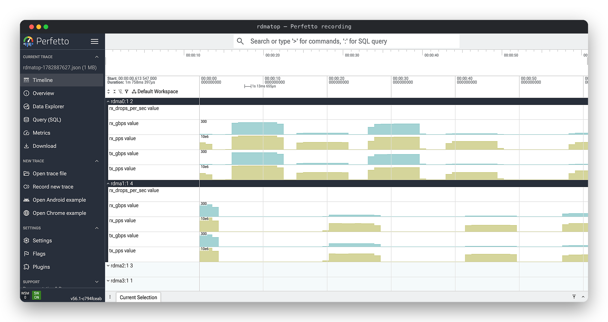

# rdmatop

[](https://crates.io/crates/rdmatop)
[](https://pypi.org/project/rdmatop/)
[](LICENSE)

`htop`, but for RDMA traffic — a real-time TUI monitor for RDMA network interfaces.

<p align="center">
  
</p>

Monitors per-device throughput (Gbps, packets/s, drops), RDMA read/write counters,
retransmits, health events, and shows which processes are using each RDMA device —
all via RDMA netlink, the same interface used by [rdma statistic](https://github.com/iproute2/iproute2/blob/main/rdma/stat.c).

## Blogs

- [rdmatop: Cross-Provider htop for RDMA Traffic](https://uccl-project.github.io/posts/rdma-monitoring/) (2026-06-15)
- [NVSHMEM Multi-NIC Support with AWS EFA](https://www.pythonsheets.com/notes/appendix/nvshmem-multi-nic.html) (2026-03-27)

## Requirements

- **Linux** (netlink-based — macOS/Windows are not supported)
- RDMA-capable NICs (e.g., Mellanox/NVIDIA ConnectX, AWS EFA)

## Installation

### Python package

```bash
pip install rdmatop
```

### Ubuntu (PPA)

On Ubuntu 22.04 (jammy), 24.04 (noble), or 26.04 (resolute) — amd64 and arm64:

```bash
sudo add-apt-repository ppa:crazyguitar/rdmatop
sudo apt update
sudo apt install rdmatop
```

### Cargo

```bash
cargo install rdmatop
```

### From source

```bash
make         # cargo build
make install # cargo install
```

## Usage

```bash
rdmatop
```

## Distributed monitoring

Monitor a whole cluster from one terminal: `htop` for every RDMA fabric
you own. Each monitored node runs an **agent**; a **viewer** aggregates
them into an ALL view and drills into any node — the drill-in is the
exact same UI as single-node rdmatop, so muscle memory carries over.

```
viewer (your workstation)                    agents (every node)
  rdmatop --nodes node1:7809,node2:7809  ──▶  rdmatop --agent --listen 0.0.0.0:7809
    ├── ALL view: one row per node
    └── Enter: drill into a node's
        per-port / per-process detail
```

### Starting the agents

```bash
# On every monitored node. --listen is REQUIRED for cross-host access:
# the default binds 127.0.0.1 only.
rdmatop --agent --listen 0.0.0.0:7809 --name gpu-node3
```

| Flag | Meaning |
|---|---|
| `--listen ADDR` | Bind address. Default `127.0.0.1:7809` (loopback only). |
| `--name NAME` | Display name (defaults to the hostname). |
| `--token-file F` | Shared secret; handshake is compared in constant time. |
| `--stdio` | Serve one viewer over stdin/stdout (SSH transport, no port). |

The agent prints its identity at startup, so a cluster logs which build
each node runs:

```
rdmatop agent 0.1.33 (v0.1.33-11-g803ea18) listening on 0.0.0.0:7809 (name: gpu-node3)
```

A systemd unit for every node:

```ini
[Unit]
Description=rdmatop RDMA agent
After=network-online.target

[Service]
ExecStart=/usr/local/bin/rdmatop --agent --listen 0.0.0.0:7809 --name %H
Restart=always

[Install]
WantedBy=multi-user.target
```

### Starting the viewer

```bash
# Comma-separated host:port; name=host:port renames a node.
rdmatop --nodes gpu-node1:7809,gpu-node2:7809,storage-01=10.0.0.9:7809

# Or one per line from a file (# comments allowed).
rdmatop --nodes @cluster.txt
```

Addresses must resolve — a placeholder that does not reach an agent
shows as DISCONNECTED rather than silently displaying the wrong host. The
local node is always row 0, so the viewer host is monitored alongside the
remotes.

### The ALL view

```
NODE              TX Gbps  RX Gbps  PORTS  PROCS    ERR/s  CONG/s  STATUS
▶ gpu-node1          97.8      0.0    8/9      4        0       -  LIVE
  gpu-node2          31.1      0.0    8/9      2    388 OB     4.9  LIVE
  gpu-node3           0.0      2.4    8/9      2      0        -  STALE 7s
  gpu-node4            -        -      -       -      0        -  DISCONNECTED
```

- **ERR/s** — hard error counters per second (`out_of_buffer`, RNR
  retries, CQE errors, drops, retransmit timeouts, ...), red, suffixed
  with the dominant counter's abbreviation (`OB`, `RNR`, `CQE`, ...)
  so the failure mode is readable without drilling in.
- **CONG/s** — congestion signals per second (ECN marks, CNPs). Yellow
  and advisory: a busy fabric is not a failure.
- Ports `active/total`, process count, and link state per node.
- Rows sort by TX; `e` filters to unhealthy nodes only (errors, stale, or
  disconnected) — the workflow that matters at scale.

### Keys in multi-node mode

| Key | Effect |
|---|---|
| `Enter` (ALL) | Drill into the selected node |
| `Esc` (node) | Back to the ALL view |
| `n` | Node picker |
| `e` (ALL) | Show only unhealthy nodes |
| `1..9` / `0` | Jump to node N / the last node |
| `Tab` | Switch the aggregated device class (RDMA / XGMI / NVLink) |
| `r` | Record a Perfetto trace |

The drill-in header leads with the node's name and hostname
(`gpu-node3 (gpu-node3.cluster)`), so you can always tell which node the
screen is bound to. A node that disconnects keeps its last values dimmed
and reconnects automatically with capped backoff.

### Protocol

JSON lines over TCP. The viewer opens with a handshake
(`{"v":1,"interval_ms":1000}`), then the agent sends one snapshot per
interval:

```json
{"t":"snap","mono_ns":1043,"sys":{...},"stats":{...},"ifstats":{...},
 "nvlink":{...},"xgmi":{...},"procs":[...]}
```

Timestamps are monotonic nanoseconds, so rate math is immune to clock
skew between hosts; the agent is a dumb forwarder of raw counters and all
rates are computed in the viewer. A stalled agent streams
`{"t":"ping"}` keepalives so the viewer reports honest STALE data
instead of flapping the connection.

**Security:** agents default to loopback; `--listen 0.0.0.0` is an
explicit opt-in. Use `--token-file` for a shared secret and keep the
fabric on a trusted network — there is no TLS yet. `--agent --stdio`
serves one viewer over stdin/stdout, which is how the SSH transport
(planned) reaches hosts without opening ports.

### Recording across nodes

`r` in a node view writes a Perfetto trace with device names prefixed by
the node (`gpu-node3/mlx5_0`), so multi-node traces remain
distinguishable in [ui.perfetto.dev](https://ui.perfetto.dev).

### Scaling notes

Memory per monitored node is roughly 30–80 KB (more for GPU nodes, whose
NVLink/XGMI snapshots dominate); a thousand agents fit in a few hundred
MB. The limits you will actually hit first:

- **File descriptors** — one socket per node. Raise `ulimit -n` (or
  systemd `LimitNOFILE`) for hundreds of agents.
- **Sampling cost** — the agent's `collect()` walks every NIC, QP table,
  and GPU serially. Many-NIC, busy-node hosts therefore refresh slower
  than the requested interval; the viewer shows that honestly as STALE.
- **ALL-view usability** — beyond a few hundred nodes use `e` to filter
  and `@cluster.txt` to manage the list.

## Perfetto recording

Press `r` to start and stop recording. rdmatop writes `rdmatop-<timestamp>.json`
to the current directory; open it in [ui.perfetto.dev](https://ui.perfetto.dev).

<p align="center">
  
</p>

## PyTorch profiler

Build from a checkout (needs `cargo` and a C++ compiler; rebuild after
upgrading torch):

```bash
pip install "setuptools>=77" "torch>=2.9"
pip install --no-build-isolation -e .
```

Call `enable()` before profiling; RDMA counters land in the same trace:

```python
import rdmatop.kineto
from torch.profiler import ProfilerActivity, profile

rdmatop.kineto.enable()
with profile(activities=[ProfilerActivity.CPU, ProfilerActivity.CUDA]) as prof:
    train_step()
prof.export_chrome_trace("trace.json")
```

## VizTracer

Add RDMA counters to a VizTracer trace from the CLI:

```bash
pip install "viztracer>=1.1.1"
viztracer --plugins rdmatop.viztracer -- my_script.py
```

Or in code:

```python
from viztracer import VizTracer

with VizTracer(plugins=["rdmatop.viztracer"], output_file="trace.json"):
    train_step()
```

Set the sampling interval (ms, default 10) and limit to specific devices:

```bash
viztracer --plugins "rdmatop.viztracer --interval 1 --devices mlx5_0,mlx5_1" -- my_script.py
```

## Examples

Use `rdmatop` to monitor RDMA traffic while running GPU
communication benchmarks:

- [PyTorch](examples/pytorch/) — intranode NVLink/XGMI traffic
- [IB Perftest](examples/ib/) — two-node `ib_write_bw` benchmark
- [UCX Perftest](examples/ucx/) — two-node `ucx_perftest` bandwidth / latency
- [NCCL](examples/nccl/) — collective communication
- [NIXL](examples/nixl/) — point-to-point KV cache transfer
- [NVSHMEM](examples/nvshmem/) — one-sided GPU communication
- [PPLX Kernels](examples/pplx/) — MoE all-to-all dispatch/combine
- [UCCL](examples/uccl/) — DeepEP-compatible expert-parallel dispatch/combine
- [RDMA Statistics](examples/rdma/) — shell-based RDMA stats
- [Kubernetes](examples/kubernetes/) — DaemonSet deployment for Kubernetes

## How It Works

1. **Device enumeration** — `RDMA_NLDEV_CMD_GET` via netlink to discover all RDMA devices
2. **HW counters** — `RDMA_NLDEV_CMD_STAT_GET` per device/port, same as `rdma statistic show`
3. **Process detection** — `RDMA_NLDEV_CMD_RES_QP_GET` to map QPs → PIDs, enriched with `/proc` data
4. **Throughput** — Two snapshots per interval, delta / elapsed for rates

## Contributing

See [CONTRIBUTING.md](CONTRIBUTING.md) for build/test instructions,
design ground rules, and how to submit changes.

## License

Apache-2.0
